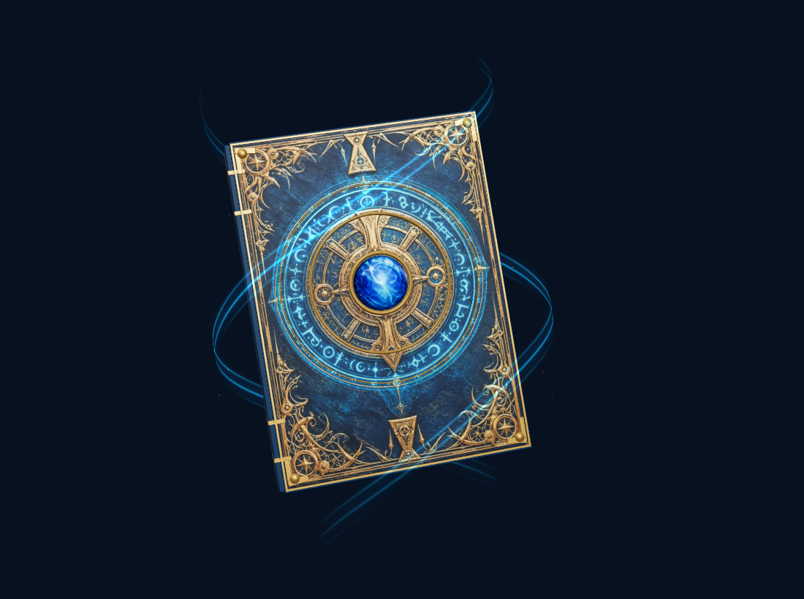
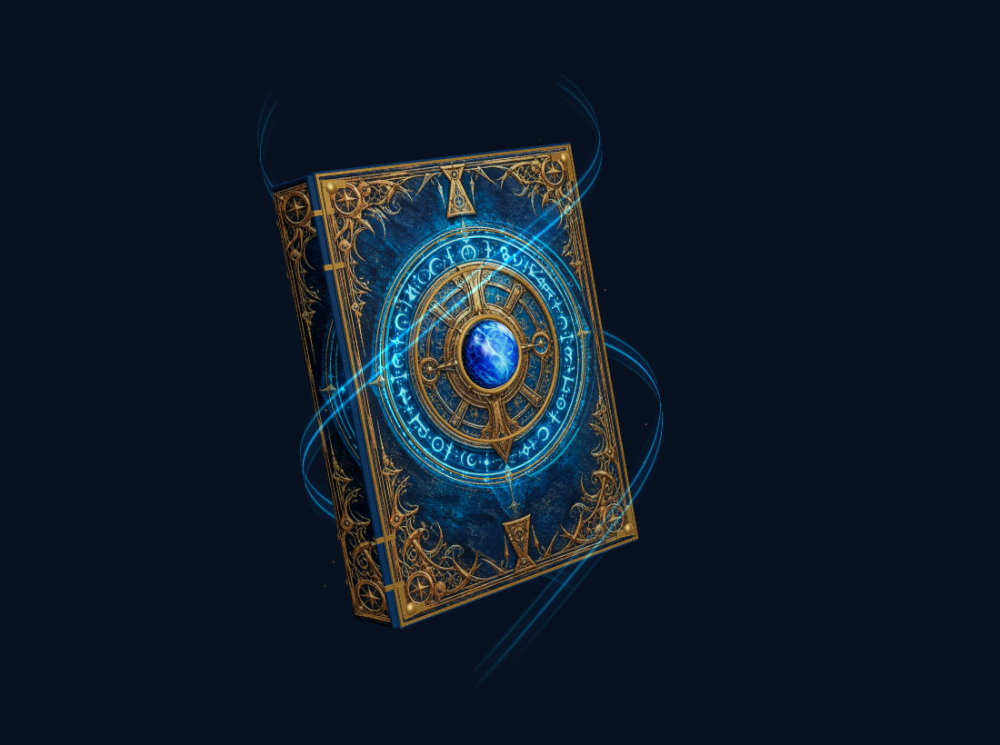

# 卷星档案库模型

> 2026-10-04 更新：本页保存旧模型设计记录。学校现采用带环绕荧光的原星核魔法书，档案库现采用 ImageGen 金黄、红、蓝三张天体纹样卡，约 25 秒一周的椭圆环绕；当前方案见[三色环绕卡牌](档案库三色环绕卡牌.md)。

日期：2026-10-03。状态：按用户提供的蓝金魔法书参考图实施，替换此前书柜。

## 设计约定

档案库直接使用一整本悬浮魔法书作为主体，尽可能还原参考图的深蓝皮革、密集镀金雕花、金色机械封印、中央蓝宝石、青色符文和前后环绕的魔法流光。取消拱顶书柜、三层彩色藏书和顶部展开小书，不增加托盘、支柱或推进引擎。

书本保持蓝／金／青配色与独立悬浮，不随岩态、气态、冰态或恒星重绘材质、魔法颜色或改变高度；场景实际光照与遮挡继续生效。保留档案库真实收藏状态、名称入口与 `/archive` 路由。

## 结构、材质与特效

- 封面与封底为实际闭合书板，书页块宽 1.35、高 1.88、厚 0.22；书本包含十五层真实侧面页缝、圆润书脊、四条镀金脊箍、四角金属包角及钉饰。转到侧面或背面可见厚度和结构。
- 正面采用 768×1068 WebP 正交贴图，保留金色雕花、皮革颗粒、复杂中央封印和蓝宝石图案。以初始化生成的 256×356 金属度蒙版区分镀金与皮革，以局部发光蒙版提亮青色纹样。封面有细微凹凸，金属硬件与三个凸起的金色封印环使用真实几何。
- 蓝宝石为弧面球壳，半径 0.155、深度比例 0.56；曲面投影复用封面对应位置的宝石纹样，保留参考图内部蓝色纹理，叠加低幅细碎魔法变化，避免变成简单糖果球或白色灯芯。
- 悬浮符文位于封面前方，有真实层间距离与深度遮挡，低速绕封印中心旋转。两束青蓝流光沿书本前后穿行，宽带边缘淡出，内部魔法纹理流动；四十八枚暖金／青色微粒缓慢浮升。
- 自发光保留青、蓝和金色，不抬高全局曝光或 Bloom，不加白色灯源。宝石仅有低强度蓝色自发光；局部青灯强度 0.035、作用距离 0.8。流光和法阵不写入深度，但仍接受实际深度测试。
- 动效使用首页共享时钟：书本上下轻浮幅度 0.025，倾角变化幅度 0.015；阅读冻结、减少动态效果静止、后台停绘。无额外动画循环、计时器或逐帧纹理上传。

## 位置与交互

独立轨道坐标 `[-0.55, 1.6, -3.5]`，根比例 0.84。书本竖直朝所在经度外侧，局部姿态为 `[-0.12, -0.1, 0.13]`，展示封面与书脊。档案库定位沿方位侧移 0.46 弧度，使魔法书避开学校标签，Web／Pad 横竖屏共用此布局。名称锚点 `[0.48, -0.19, 0.42]`，显示「档案库／星核魔法书」。左右拖动和滚轮仍仅改变竖轴方位。

## 资产与实现

- `src/components/juan-world/magicArchive.ts`：书本、立体宝石、独立材质、法阵、流光与微粒。
- `public/assets/juan-world/archive-cover.webp`：生产封面贴图，约 397 KiB。通过内置 imagegen 工具生成，再做尺寸／WebP 优化；不是直接截取用户图片。
- `models.ts` 的工坊统一缓存、合并与释放资源；异步贴图到达后唤醒首页，减少动态效果时也可看到完整贴图，退出场景后的回调不会重新开始绘制。加载失败时可完成场景初始化并保留原生书本结构。
- `runtime.ts`：独立轨道、档案库定位、贴图完成后更新；`facilityAppearance.ts`：魔法书与学校／总部一起跳过主题材料绑定。
- 四套场景回退图和标签投影点由真实场景同步导出。

### 生成说明

工具：内置 `image_gen.imagegen`；参考图：用户本轮提供的蓝金魔法书。最终提示词：

> Use case: stylized-concept. Asset type: orthographic PBR book front cover albedo texture for a real 3D enchanted archive book in a website. Reference image shows the requested magic tome. Recreate ONLY the rectangular front cover as a flat straight-on image, no perspective and no thickness, cover fills entire portrait image edge to edge. Preserve dark rich midnight blue/teal grained leather, intricate delicate aged GOLD embossed filigree at all four corners, gold double border, ornate central concentric gold mechanical arcane seal occupying 65 percent of width, curling inscriptions and symbols, triangular clasps/ornaments at top and bottom. At exact center small round vivid blue sapphire (diameter about 16 percent of cover width). Fine cyan rune ring within central gold seal, clearly distinguishable gold engraving and azure magic details. Match ornate luxurious craftsmanship of reference closely. Neutral even lighting, understated colored accents, no bloom or glare, no cast shadows, no surrounding space or floating papers, no blue ribbon outside cover, no readable text, no watermark. Entire cover straight rectangular aspect width:height 0.72, align the circular seal center with exact image center. Detailed genuine leather and embossed gilded metal, NOT simplified cartoon, NOT black empty surface. This is a flat material texture not a picture of the book.

## 验证

仅首页 UI 修改，按 AGENTS.md 不运行 E2E。执行实际模型近景、Web／Pad 横竖屏、四种星球材质独立性和同画布切换巡检，并完成类型检查、定向 ESLint、生产构建和既有包体预算检查。最终结果见下方补充记录。

最终结果：实际模型正面及侧面近景、Web 1440×900、Pad 768×1024／1024×768 的档案库定位均已检查。定位侧移到 0.46 后，封面避开学校标签，书身完整可见，宝石、金色雕花、法阵和流光保持可辨。四套星球切换复用同一画布，模型隔离巡检确认书本材料的颜色、粗糙度、金属度和清漆参数均未随主题变化；两次不同时钟值的近景显示符文与流光变化，侧面可见实际书脊和书板厚度。页面／控制台无错误；生产预览中的档案库定位也已检查，贴图与法阵正常加载。

四套真实场景海报及投影点已更新，生产目录的四张海报与封面 WebP 均与源文件哈希一致。全项目 TypeScript、定向 ESLint、完整生产构建及原包体预算通过：场景 runtime gzip 32.1 KiB，Three.js 核心 143.2 KiB；单 JS 包仍限制 170 KiB、CSS 120 KiB，没有放宽预算。近景使用独立展示相机，不改变首页固定俯仰；软件 GPU 巡检不代表真实 Pad 帧率。

实际模型预览：

