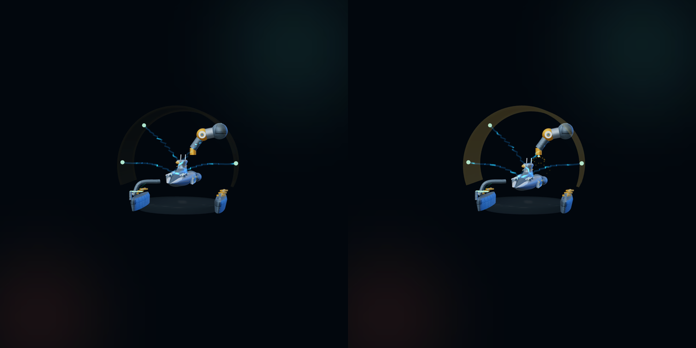

# 卷星船坞模型

## 金色外围遮罩（2026-10-04）

按用户最新确认，船坞外围薄玻璃遮罩改为金色，覆盖此前绿色要求：基色 `#f4cd69`、发光色 `#e9b13f`。高亮周期由 10 秒缩短为 5 秒，每次约 1.7 秒平滑亮起并淡出，间隔更紧凑。

保留薄玻璃的 0.012 场景单位壳厚、0.008 光学厚度、常态 7%／峰值 13% 不透明度，便于看清内部维修飞船。峰值发光强度 0.55；玻璃底盘、四路充电电弧、机械臂与焊接火花保持各自效果。金色遮罩在四种星球主题中一致。

动画共用场景时间，静态模式／减少动态效果时随场景冻结，没有额外计时器。布局与 Web／Pad 适配遵循[首页建筑布局](首页建筑布局.md)。实现位于 `src/components/juan-world/models.ts` 的 `harbor`。

验证：实际渲染检查 0 秒常态与 3.95／8.95 秒的两次高亮峰值，颜色及峰值参数一致；Web／Pad 横竖屏定位可见，无页面错误。定向 ESLint、类型检查、生产构建与预算通过。本轮仅 UI，按 AGENTS.md 不运行 E2E。
