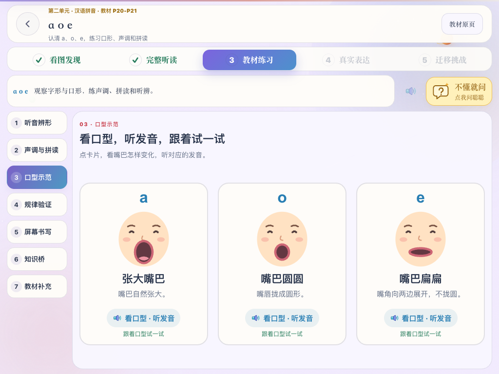
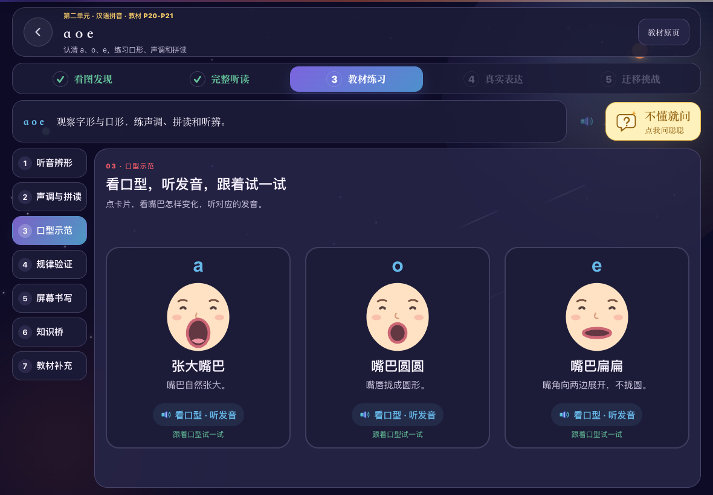

# 拼音口型示范

2026-10-11：修正 a/o/e 课程把“发 a 的口形”等口型说明混入图文词语的问题。原卡片只朗读说明文字，没有展示口型，且错误显示“已读词”。

## 内容与交互

- a/o/e 的教材练习第三个 tab 改为“口型示范”，标题为“看口型，听发音，跟着试一试”。其他拼音课保持图文识字与词语点读。
- 三张正面口型示意直接展示：a 自然张大嘴巴，o 嘴唇拢圆，e 嘴角向两侧展开、不拢圆。图形分别使用纵向张口、圆形开口、横向扁平开口，提示文字直接可见。教学口诀与本课既有内容一致；相关教学参考见[扬州大学小学识字与写字教学材料](https://wxy.yzu.edu.cn/__local/0/1A/9F/593268E1EB9DFB1B08DA9992915_2DBDD149_8609C6.pdf)。
- 点击卡片，口型由闭合变为目标形状，并播放对应的单韵母一声 ā/ō/ē。a/e 使用已有录音，o 保持已有单韵母合成规则。按钮不会只朗读“发 a 的口形”。
- 动画与播放均结束后记录“已看示范”；静音时仍能观察演示。仅表示看过示范，不评价孩子是否发音正确。开启减少动态效果时直接展示最终口型。
- 三项观察完成后自动进入下一项未完成活动；手动返回已完成 tab 时仍可停留和重复演示。快速换卡片、切 tab、离开页面取消旧演示和音频，取消的观察不计入完成。
- 进入 tab 只播操作说明，不自动逐张朗读卡片。口型观察使用独立进度字段 `pinyinMouthForms`，不把旧“已读词”进度冒充看过口型。
- Pad 横屏三张卡片一屏展示，无滚动条、无分页。SVG 属于口型正面示意，展示唇形，不展示舌位剖面。

## 实现与验证

- `src/components/PinyinMouthDemo.tsx` 与对应 CSS：口型图形、变化动画、音频及取消处理。
- `src/content/chinesePinyinStudy.ts`：口型示范独立字段，不再使用虚构词语占位。
- `src/pages/ChinesePinyinStudyStage.tsx`：活动名称、内容及完成推进。
- 相关单元测试 7 项通过，覆盖口型差异、只点读对应音、演示结束前不计完成、取消旧演示与已有教材内容。
- 相关 E2E 3 项通过：1024×768 浅色、1180×820 深色下观察、取消、自动推进、手动返回重播和四声演示的关联跳转。两种尺寸卡片完整可见，页面无滚动。

