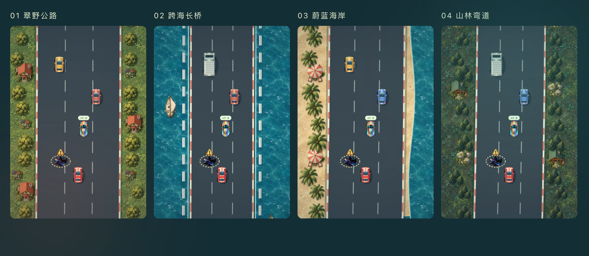

# 火箭车 · Road Fighter

状态：2026-10-04 新增。入口为「空中乐园 → 敏捷 → 火箭车 → 驾驶火箭车」，在 `/lobby` 内展开；与其他游戏共用单一游戏容器。

## 玩法与还原目标

以小霸王 FC《Road Fighter》的俯视公路竞速为基础：红色跑车、两档油门、燃油倒计时、不同颜色车流、反打方向救车、彩色补给车和四段赛道。采用原生 Canvas 与规则引擎重新实现，画面为原创细绘重制；按用户要求接入原版 FC 音频录音。应用不包含游戏 ROM、模拟器或原游戏图像。

规则交叉参考：[FC 版本资料](https://www.arcade-history.com/game/54543/road-fighter)、[NES 攻略](https://gamefaqs.gamespot.com/nes/578237-road-fighter/faqs/27336)、[Road Fighter 玩法介绍](https://zh.wikipedia.org/wiki/公路戰士)。不同版本资料中的低档速度和补给量存在差异，本作采用熟悉的 196 / 400 km/h 与 +7 燃油。赛道距离、弯道、车流种子、燃油消耗与部分计分为本作调校值，未做 ROM 逐帧复刻。

- **目标**：燃油耗尽前驶过终点，依次完成四段赛道。没有额外生命条，撞车的代价是时间与燃油。
- **油门**：B 低档迅速起步，封顶 196 km/h；A 高档封顶 400 km/h。按住持续加速，松开滑行；高速时按 B 可减速至低档。同时按 A/B 时优先高档。
- **转向**：沿连续横向坐标移动，方向改变不受固定车道限制。左右同时按住时保持当前横向位置。
- **燃油**：开局 100，每秒消耗 `0.9 + 0.75 × 速度 / 400`；停着也耗油。撞车额外扣 5；碰到彩色补给车加 7，上限 100。耗尽后减速滑行，若在停车前接到补给仍可继续；停下才结束。
- **车流**：黄车保持直线；红车接近时向玩家所在车道切线一次；蓝车有摆动、追踪、快速横摆三种行为；卡车保持直线且撞到直接爆车。彩色补给车沿路行驶，油污固定在路面。
- **打滑与救车**：碰到普通车辆或油污后发生侧向漂移，车速下降。按漂移反方向明显缩短打滑并触发救车反馈；朝漂移方向转向不会触发救车。滑进护栏会爆车。
- **撞车恢复**：爆车停顿 0.9 秒，速度归零，在当前路段中央复位，保护 1.6 秒。保护期间仍被限制在护栏以内。
- **计分**：行驶每米 0.32 分；成功超过普通车辆 / 卡车加 50；补给加 1000；终点把剩余整格燃油乘 100 加入分数。除了长桥，未爆车行驶到 58% 路段会出现原创飞行小英雄并奖励 1000 分，致敬经典彩蛋。
- **过关**：终点暂停等待「下一段赛道」，下一关加满油、停在起点；保留累计分数、超车 / 补给 / 撞车统计和有效时长。四段完成显示胜利；GAME A 胜利后可选择挑战 GAME B。
- **模式**：GAME A 经典车流；GAME B 车辆与油污更密集，蓝车横向行动更快。只在待开始 / 整局结束时允许切换模式。
- **车流舒适度调整（2026-10-04）**：根据实际试玩反馈，两档普通车辆密度减少约一半，生成间隔从 A / B 的 64 / 49 米调整为 128 / 98 米，空出更充足的超车通道；保留各色车行为与补给频率。
- **补给车与敌车重叠修复（2026-10-04）**：原先仅检查生成间距，较快敌车仍会追上并穿过补给车。现在生成时避开补给车前后 34 米，行驶时先处理全部车辆的位置与避让，再进行玩家碰撞 / 补给判定。相近车道（横向间隔不足 44 逻辑像素）的车辆保持至少 34 米纵向距离，包含加油标记与卡车车身的显示余量；红蓝车不能变道进入附近车辆占用的空间。后车跟随前车，通道清空后恢复原定速度；横向分开的车辆可正常并排与超越。补给车仍为 96 km/h、每次 +7 油，A / B 生成间隔和油污规则保持原设定。

## 四段公路与视觉

| 赛道 | 距离 | 视觉与驾驶区别 |
|---|---|---|
| 翠野公路 | 6.0 km | 宽公路、草地、阔叶树、暖色屋顶、里程牌 |
| 跨海长桥 | 6.8 km | 窄桥、桥墩、双层护栏、流动海面与小船 |
| 蔚蓝海岸 | 7.2 km | 沙岸、沿海道路、白色浪线与更明显的弯道 |
| 山林弯道 | 7.8 km | 松林、岩石、道路收窄与连续山道 |

逻辑画布 480×680，按照设备像素比最高 2 倍渲染。车身提供金属渐变、挡风玻璃、后窗、车轮、镜面、车灯和落地阴影；玩家红车带白色赛车条纹。道路按世界距离滚动，具有交替路肩、虚线、起终点棋盘格和里程标识；打滑显示轮胎痕，爆车显示火花。

路面油污采用扩大、实色的黑紫油斑、紫青反光纹、浅金色虚线警示边界和黄色感叹号三角标记。Web / Pad 缩放后仍可提前辨识，保留原碰撞判定，警示圈用于帮助观察。

### ImageGen 道具与沿途景物升级（2026-10-04）

按用户要求，用内置 ImageGen 绘制三套素材图集，并将 17 张独立 WebP 接入 Canvas；原始 PNG 图集、最终提示词和裁切清单保存在 `docs/assets/road-fighter/imagegen-v1/`，运行素材保存在 `public/assets/games/road-fighter/`。生成提示词全文见 [prompts.json](assets/road-fighter/imagegen-v1/prompts.json)，素材坐标和尺寸见 [manifest.json](assets/road-fighter/imagegen-v1/manifest.json)。

- **道具与警示**：补给车采用彩虹金属漆、深色车窗和真实车灯；油污采用不规则黑色油斑及紫青油膜反光；黄色立体警示三角与金色虚线圈叠加，保持小屏危险辨识度。燃油仪表加入金色油桶图标。
- **草原**：手绘草地纹理、层次分明的阔叶树、野花与红瓦村舍，景物错落分布在道路两侧。
- **长桥**：细腻海水纹理与帆船，保留桥墩和双层护栏。
- **海岸**：沙粒纹理、棕榈树、沙滩伞和躺椅，与海面、浪线组合。
- **山林**：苔藓林地、松树丛、岩石与木屋，以冷绿材质体现山地环境。

所有透明景物保留 alpha，不带棋盘背景；地表贴图跟随世界距离滚动。精灵按原比例绘制，景物位于护栏外，游戏道路后绘制以避免遮挡车辆。图片统一预解码并缓存，纹理图案按画布缓存；加载失败时使用既有程序绘图作为回退。本次为视觉升级，保留此前减半的车流密度、补给频率与碰撞规则。

整体采用墨绿街机主机、鼠尾草绿与暖珊瑚色手柄、实时速度弧表、20 段燃油仪表、路线节点和细绘赛道。深浅主题改变界面材质配色，游戏内道路保持一致的辨识度。减少动态效果偏好关闭装饰闪烁和尾气，不影响驾驶反馈。

## 原版 FC 音频（2026-10-04）

根据「音乐太难听，使用原版音效」的反馈，删除原创循环脉冲旋律及合成驾驶音效，改为播放原版 FC 录音。原版驾驶期间没有持续背景旋律，只有车辆与驾驶事件声音；起跑、关间、最终胜利和失败使用各自的短曲。

录音取自 [Zophar's Domain · Road Fighter](https://www.zophar.net/music/nintendo-nes-nsf/road-fighter)。运行素材位于 `public/assets/games/road-fighter/audio/`；[manifest.json](../public/assets/games/road-fighter/audio/manifest.json) 记录每个来源链接、源文件 SHA-256、对应声音指令、加工方式和长度。原游戏音频归 Konami 所有，归档下载不代表开放源代码授权。

| 游戏场景 | 原版录音 | 播放方式 |
|---|---|---|
| 开始 / 下一段 | Track 1 · Game Start | 单次；继续比赛和重新开声音不重播 |
| 第一至三关终点 | Track 2 · Check Point | 单次，关间等待时保留短曲 |
| 第四关终点 | Track 3 · Goal | 单次 |
| 燃油耗尽停车 | Track 4 · Game Over | 单次 |
| 行驶 | 原版驱动三角波声道，声音指令 `0x89` | 以车速 196、高档离线录制 2 秒循环，播放速率随车速变化；停车和爆车时静音 |
| 油量不足 | Track 8，声音指令 `0x01` | 仅在 `0 < fuel < 10` 时循环，固定原速；补给至 10 或以上、耗尽、静音及暂停立即停止 |
| 爆车 | Track 6，声音指令 `0x0f` | 截取与 0.9 秒爆车停顿匹配的片段 |
| 打滑 | SFX 1，声音指令 `0x03` | 单次；救回或爆车立即结束打滑音 |
| 补给 | SFX 5，声音指令 `0x08` | 单次 |

短曲和音效只裁去末尾静音，并统一为单声道 22050 Hz MP3；引擎采用 PCM WAV，循环边缘使用 5 毫秒淡入淡出以避免接缝爆音。9 个音频文件合计约 467 KiB；短曲及警报处理脚本为 `scripts/assets/prepare-road-fighter-audio.py`，发动机由 `scripts/assets/render-road-fighter-engine.py` 单独录制。发动机变速是本作的录音播放调校，不是 ROM / APU 逐帧仿真；救车、空油滑行和原创彩蛋不再附加自编旋律。

进入游戏预取录音，第一次有效操作时才启用 AudioContext。解码后缓存，加载失败保持安静，并可在后续启动时重试。声音开关、暂停、失焦、切后台、重开和离开会停止所有已播节点；异步下载 / 解码完成后也不能复活已取消的声音。离开关闭音频设备。

## Web / Pad 操作与生命周期

- Web：`← → / A D` 转向，`Z / J` 低档，`X / K / 空格` 高档，`P / Escape` 暂停，`Enter` 开始、继续或下一关。画布获得焦点时响应游戏键，防止拦截其他页面操作。
- Pad：独立左右方向与 B/A 油门，通过 Pointer Capture 跟踪多根手指，可边转向边踩油门。抬手、取消、丢失捕获、失焦与离开游戏会清理按键。
- Web 与 Pad 横屏为赛道 / 仪表双列；Pad 竖屏紧凑双列；窄屏先赛道和手柄，再排列仪表。游戏画面与按钮不产生横向溢出。
- 暂停、窗口失焦或切后台冻结驾驶、油量、车流与有效时长；继续比赛时输入从释放状态恢复，避免方向和油门黏住。
- 原版起跑 / 过关 / 结束短曲、发动机和驾驶音效跟随全局声音开关。暂停 / 离开停止并释放音频节点。

## 记录与工程结构

燃油耗尽停车或完成四关时，只写入一次 `sky-road-fighter` 游玩记录。GAME A / B 分别对应 `level: 1 / 2`；胜利 `correct: 1`，失败为 0，`total: 1`，`stars: 0`。有效驾驶时长包含爆车停顿，不包含暂停、开始前和关间等待。中途重开、切分类或返回不结算弃局；不发课程星、卷星币，也不改变掌握度。

规则位于 `roadFighterEngine.ts`，绘画位于 `roadFighterArtwork.ts`，ImageGen 素材预解码与绘制位于 `roadFighterSprites.ts`，音频位于 `roadFighterAudio.ts`，交互与仪表位于 `RoadFighterGame.tsx` / `road-fighter.css`。规则独立于 React 与浏览器；碰撞使用 1/120 秒子步，避免低帧率穿车。动画走 Canvas，React 仪表约每 80 毫秒更新。

## 验收

- 规则单测：`npx vitest run src/__tests__/roadFighterEngine.test.ts`，13 项通过，覆盖双档、碰撞 / 救车、补给、耗油滑行、车流 AI、四关结算和子步稳定性；另以真实时间步连续驾驶四段赛道，验证移动补给可追及与燃油经济。
- E2E：`npx playwright test e2e/road-fighter.spec.ts --workers=1`，6 项通过，覆盖 Web 操作、有效暂停、记录幂等、声音，以及 768×1024 / 1024×768 Pad 和 390×844 窄屏的真实多点触控与深浅主题。
- 执行 TypeScript、针对改动文件的 ESLint 与生产构建 / 包体积检查。不运行其他游戏、课程和服务端的全量用例。
- 车流减半与油污强化后：重新运行 13 项规则单测及 `npx playwright test e2e/road-fighter.spec.ts --workers=1 --grep 'Web'`（1 项通过），针对改动的 ESLint 与 `npm run build` 再次通过；四段赛道与窄屏手柄截图已目视复核。
- ImageGen 视觉升级：运行改动文件的 ESLint、TypeScript 和生产构建 / 包体积检查；通过浏览器截图复核四段赛道与 1440×1100、768×1024、1024×768、390×844 的深浅主题，17 张运行素材全部加载，未出现页面错误或横向溢出。按仓库约定，本次仅修改 UI，不运行 E2E 或重复规则测试。
- 原版音频替换：`npx vitest run src/__tests__/roadFighterAudio.test.ts`，6 项通过，覆盖短曲与引擎、暂停后解码迟到、救车取消打滑、静音 / 离开释放以及素材失败重试。仅运行 `npx playwright test e2e/road-fighter.spec.ts --workers=1 --grep '原版声音'`（1 项通过），真实浏览器解码 8 个音频素材并验证声音开关 / 暂停 / 返回；未启动合成振荡器。改动文件 ESLint、TypeScript、生产构建与包体积检查通过。
- 补给车重叠修复：规则单测 16 项通过；新增快敌车追尾补给、红蓝车并排变道避让、邻道正常超越与四段赛道 / 两模式 / 三种种子的连续行驶回归。验证补给正常前进、收集时不同时碰敌车，以及补给移除后后车恢复原速。仅运行相关 Web E2E（1 项通过）；改动文件 ESLint、TypeScript、生产构建与包体积检查通过。

## 发动机与低油量警报更正（2026-10-04）

此前错误地把归档 Track 8 的低油量警报当作发动机，并让警报随车速变调。本轮替换为原版声音驱动的驾驶三角波声道 `$89`，将 Track 8 放到独立的低油量警报声道，恢复正常加速时的发动机声音。两个运行文件分别为 `engine-fc-v2.wav` 和 `low-fuel-fc-v2.wav`。

警报只在油量大于 0 且小于 10 时启动，连续帧不重复创建声道，不随车速或档位变调。补给恢复至 10 或以上、耗尽、暂停、静音和离开立即停止；补给也会取消尚未加载完成的警报，继续比赛只恢复当前仍然需要的声音。仪表现有小于 20 的视觉提醒保持不变。

发动机使用 [原版 NSF](https://www.zophar.net/music/nintendo-nes-nsf/road-fighter) 声音驱动与 [libgme 0.6.5](https://github.com/libgme/game-music-emu/tree/0.6.5) 离线录制，应用只播放 WAV，不运行模拟器。原始 NSF SHA256 与寄存器配置记录于音频 manifest，录制脚本核对 SHA256 后仅修改离线初始化包装：选择发动机声音指令、设置原版车速 RAM `$0068/$0069` 为 196、高档键位 `$07=$80`，原声音驱动保持原样。先播放 0.25 秒预热，截取 2 秒单声道 PCM，边缘作 5 毫秒淡入淡出。复现命令：`python3 scripts/assets/render-road-fighter-engine.py SOURCE.nsf LIBGME_LIBRARY`，需要本地 libgme 0.6.5 动态库；普通素材处理脚本保留已录制的发动机配置，避免重新把 Track 8 用作发动机。

波形报告见 `docs/assets/road-fighter/audio-v2-verification.json`。本轮只跑火箭车音频单测和发动机 / 低油量警报相关 E2E，不运行其他游戏用例。

本轮实际验证：音频单测 8 / 8 通过；“低油量警报与发动机分开”和“原版声音跟随全局开关”两个相关 E2E 均通过；低油量用例通过真实燃油消耗等待进入警报区和耗尽，按实际波形区分发动机与警报，而非信任素材文件名。该用例使用 120 秒执行上限，避免约 114 秒模拟驾驶受到默认 40 秒上限截断。定向 ESLint、TypeScript / Vite 构建及包体预算检查通过。发动机离线重复录制 SHA256 一致。
