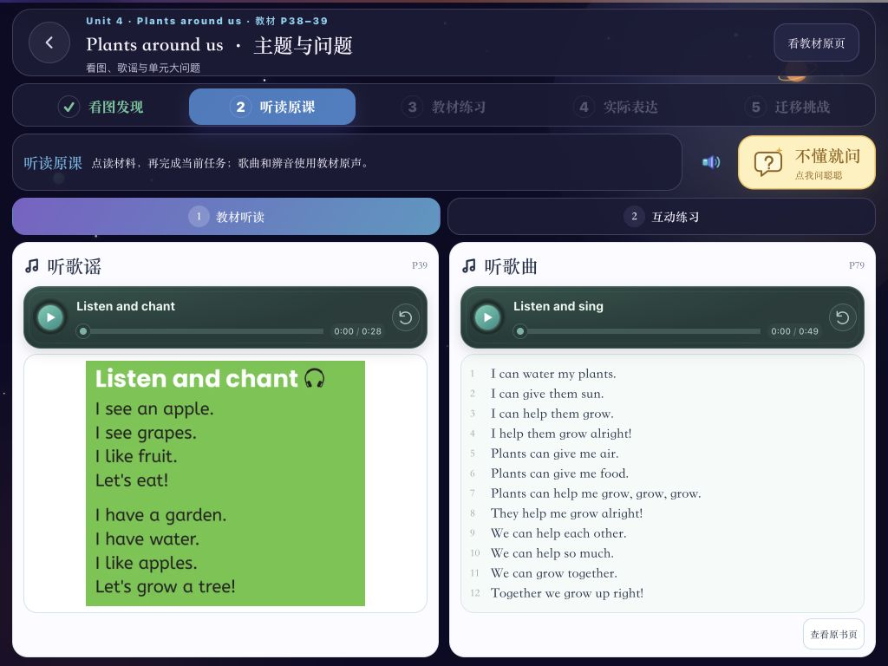
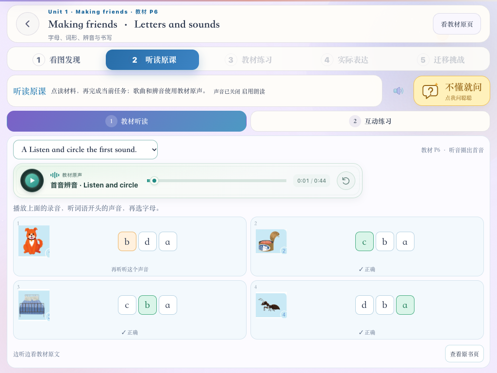
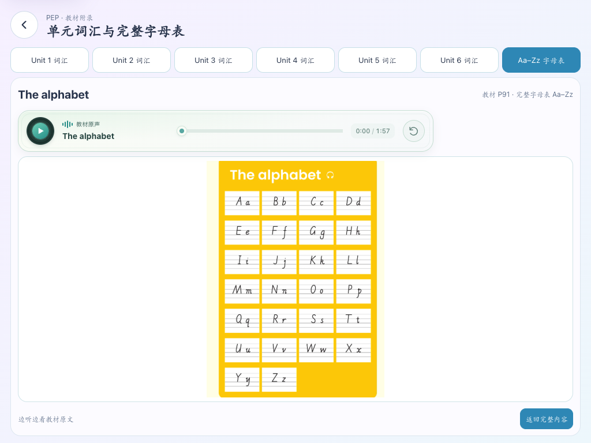

# 英语教材音频对应检查

2026-10-11，依据用户要求检查教材与全部 74 段录音，补充缺失材料并纠正绑定。

## 检查发现与修复

| 问题 | 本轮处理 |
| --- | --- |
| 整册字母表录音被绑定到六个单元的局部字母卡 | 独立教材附录入口，完整展示 26 组大小写及 P91 原书字母表。 |
| 附录词汇录音被放在 Part A/B 局部词汇中 | 独立六份完整词表，顺序、中文释义及跨页材料对应 P83–85，共 108 个词条。 |
| 教材首音／尾音录音出现在自编三步拼读任务旁 | 补齐七组原书辨音题，共 27 个原书图片及原选项；成功播放后作答、自动判断，可重听重选。自编任务保持独立。 |
| 六段 Project 原声缺少对应听力问题／图片 | 六课分别补上原书的交友动作、家庭图片、动物、水果与人物、颜色、生日人数及年龄题。原有项目制作操作保留在互动练习。 |
| 复习录音仅凭 P74/P76 混配，P77 被放在无关礼貌列表旁 | 五段分别对应 Listen and tick、Read aloud、Read and talk、Being a good guest 歌谣、Fill in the blanks and sing a song 的字母填空；不把 P77 礼貌列表冒充字母歌曲文字。 |
| 对话／活动只显示改编短句，少了实际录音中的原话 | 听读主区提供该录音对应的完整原书对话／动作／歌谣；原有点读和表达练习保留。 |
| 部分歌曲只有正文中的标题，字母歌谣续页未呈现 | 歌曲采用附录全部歌词，字母录音同时提供主课字母例词及 P80–82 两部分歌谣文字，保留所有续页。 |
| 单元开篇歌谣标成前一页 | 修正为实际 P3、15、27、39、51、63。 |
| 字母 C 的例词 can 被解释成“会；能” | 按 P6 猫与罐头盒情境改为“罐头盒”；附录单元词汇的 can 仍按 P7 情境解释为“可以”。 |
| 原书拼读示范词缺失 | 六单元分别补上 dab、bed、big、nod、cut、wet，保留原教材后续拼读词。 |

## 可持续维护的约束

1. 74 段的来源 ID、MD5 与官方文件一一核对；具体明细见 [全册对应表](英语教材原声.md#当前全册对应表)。
2. `lessonIds` 明确指向单个课时／附录入口，`slot` 指向具体活动，`material` 明确记录印刷页、原文／原题区域及续页。不支持仅凭页码筛选录音。
3. 文本合成点读与教材原声各自对应材料，不能朗读选项来替代只有录音才包含答案的题目；附录不插入无关练习。
4. 播放不会改变课时完成状态或发放奖励；新增原书阅读为选学材料，既有互动任务、历史进度与重复练习保留。
5. 原书图片按已核对区域生成，不裁掉录音中的内容；当前共 91 幅录音材料和 27 幅辨音题图。图片用于保留教材准确内容；词表、字母表和辨音题另提供清晰的一屏排版。歌曲完整歌词与重复句直接同栏展示，同课两段／三段录音并排两栏／三栏。
6. 只支持 Pad 横屏，不出现页面或正文滚动条。续页按钮只切换显示材料，不拆成多个录音、不重置播放进度。

## 检查依据与限制

检查官方 99 页 PDF 的正文、附录渲染图，按耳机标记与栏目定位；核对 74 个源文件的标题／来源 ID／MD5，并校验网页 MP3 可解码及完整时长。所有录音在本机进行辅助转写；歌谣和带伴奏内容的转写有遗漏，因此以原书附录文字和原音栏目共同核对，不声称自动转写逐字可靠。不上传孩子音频，也未引入付费语音评测服务。

## 验证记录

以下 11 项单元测试、9 项 E2E 与构建记录来自音频对应修复；后续并排展示属于纯 UI 调整，未重跑 E2E，页面核对记录见 [展示规则](英语课文展示规则.md#2026-10-11-原声与原教材材料)。

- 相关教材数据单元测试：3 个文件、11 项通过，覆盖明确绑定、108 词条、can 的两种语境、七组真实辨音词与选项。
- 专项 E2E：9 项全部通过，逐一进入 74 段对应栏目，检查播放器路径、MP3 请求、91 幅原书材料／续页加载、完整附录内容和 1024×768 无滚动条；检查各歌曲全部段落文字顺序、行高和切页时音频路径保持，以及成功播放后辨音作答、错误重选、自动反馈、自编拼读无错配录音和目录进入附录。
- 人工图片检查：正文对话、歌曲、字母歌谣跨页、六个项目听力题、复习题、完整词表／字母表及辨音图片；纠正开篇文字和局部图片的裁切边界。
- TypeScript、相关文件 ESLint、生产构建及包体检查全部通过；入口包 gzip 169.2 KiB，在现有 170 KiB 上限内。

页面示例：

