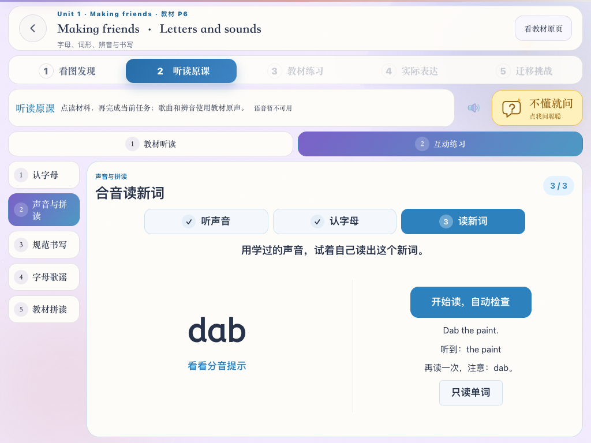

# 音频自动检查

2026-10-09 确定：只使用页面内麦克风收音，移除音频文件上传。最初英文跟读复用浏览器语音识别；2026-10-11 用户确认回听清楚但转写错误后，英语固定词句改用服务端本地专用识别模型与页面内容比较；不接入新的讯飞收费服务，也不为普通跟读调用通用大模型。

英文教材跟读窗口沿用原来的居中小播放器样式：圆形词图或麦克风、收音波形、逐词高亮、圆形收音按钮和精简状态提示。识别后的进度条表示内容匹配程度，不称发音得分。窗口无需展开普通课程检查面板，通过后自动收起，保留重读。

## 跟读与固定词句

- 英文教材跟读、角色台词、示范句表达、拼读目标词、复习词句，以及纯汉字课文的选句跟读，共用 `SpeechReadingCheck`。普通教材点读先播放示范，孩子点击收音按钮开始读；中文选句跟读窗可以直接开始收音。
- 英语使用 `useLocalReadingAsr`：页面 MediaRecorder 录音，转为16 kHz单声道 PCM，经自有服务端的 SenseVoiceSmall 转写；识别器只收到音频与英语语言，不收到题目或答案。中文 `useAsr` 保留浏览器 `SpeechRecognition` / `webkitSpeechRecognition`（zh-CN），临时结果只显示，最终结果或收音结束的文字才用于核对。不接受孩子或家长填写的“已经读过”声明。
- 识别文字与目标按顺序核对。英文以词为单位，中文以字为单位；忽略大小写、标点，兼容常见英文缩写和 0–20 的数字转写。目标覆盖率与识别结果匹配率都达到 85% 才自动记录完成，短词必须完整匹配。多说大量无关内容不能靠包含目标词通过。
- 未通过提示“识别结果与目标不同”，允许重复收音，不把服务转写失败直接归因于孩子发音错误。开始收音暂停页面示范语音和教材原声，等待识别器就绪后提示“正在听”；关闭窗口、更换目标、隐藏活动或卸载立即取消识别。英语单词最多收音12秒、句子44秒；实际开口后停顿约1秒／1.8秒自动结束，也可点击结束。音量与停顿只决定何时结束录音，不决定答案正确。结束后等待自有服务端识别，错误、静音或服务不可用均不能记完成。中文保留浏览器停止与结果等待机制。旧会话迟到的结果不能完成新题。
- 通过记录为 `source: check`，表示自动内容检查。已有 `ai` / `self` / `adult` 等记录与历史进度保留，重做不会撤销原完成状态。

这里检查的是“识别出的内容是否对应目标”，不能据此判断精准发音、声调、响亮程度或音素错误，也不显示所谓发音分数。原有只比较目标覆盖率的算法容易放过大量无关内容，现改为同时核对覆盖率和匹配率；不采用开口时长来确认读对。

英语识别在部署本系统的服务器上离线推理；页面会将本次录音传给自有服务器，不发给第三方识别 API，不提供选文件上传。录音与回听仅在内存保留，不写入磁盘。中文浏览器识别仍可能使用厂商联网服务。当前不调用新增的收费评测 API；不可用时保持待检查，允许重试。参见 [SpeechRecognition 文档](https://developer.mozilla.org/en-US/docs/Web/API/SpeechRecognition)。

## 其他需要声音的任务

自由表达、原声理解和拼音声调等任务不能只靠固定词句匹配完成全部标准，使用页面内录音，点「说完了」直接自动判断，不再另点提交录音或 AI 确认。通用开放作答不增加回听和确认步骤；音频在当前页面内存中保留用于失败重试，检查时转为 16 kHz、16 位、单声道 PCM WAV；混合双声道，不丢弃另一个声道。超过 45 秒的内容拒绝提交，不默默截断；自动录音在 44 秒停止，为停止事件留出余量。重新录制时先清除旧音频，失败不会误提交上一份录音。

这些任务仍需要部署环境配置支持原始音频的检查服务。未配置、失败、超时或无法判断时保持待检查，不用识别文字冒充声调和发音证据。当前未接入独立发音评测引擎，若后续确实需要精确发音评分，再单独决定提供商和费用。

## 验证

自动化测试使用模拟麦克风、服务端转写响应和中文浏览器识别器，覆盖正确内容、错误词、漏读、乱序、无关内容、数字/缩写、静音、权限失败、超时、旧会话结果、自动推进、录音重试和无文件上传入口。测试验证流程和规则，不代表已验证真实浏览器的儿童语音识别准确率。

## 短词识别与收音结果保留（2026-10-11）

修复原流程只接收最终识别第一条候选的问题。`SpeechReadingCheck` 的临时文字即时显示在“听到”行，临时文字在收音结束前不直接记完成。检查识别器实际返回的候选，必须仍满足原内容规则；不把 dad／bad 自动映射成 dab，不放宽为任意相似拼写，不使用录音时长代替读对。通过后停止当前收音，避免已经通过的文字被后续结果覆盖。

麦克风启动、识别就绪、等待结果、没有识别文字、网络失败、麦克风权限拒绝与读出的内容不符分别提示。固定词句跟读等待 `audiostart`（实际采集已开始）后才显示“正在听”，不把识别服务的 `start` 当作麦克风已经就绪。启动12秒仍未就绪时释放会话并允许重试，不一直停在准备状态。开始收音会暂停合成示范和教材原声，避免播放声音干扰。

六单元新词 dab／beg／bib／mop／rug／wax 识别失败或内容不符后提供“放进短句再读”，直接显示已有任务的对应短句。辅助模式核对完整句子，缺少目标词不能通过，成功记录为 `source: check`、`level: supported`；可以切回“只读单词”。原有分音提示与任务内容保留，短句提示不用新收费服务或通用大模型，不增加音频上传。

实现参照浏览器的 [临时结果](https://developer.mozilla.org/en-US/docs/Web/API/SpeechRecognition/interimResults)、[候选数量](https://developer.mozilla.org/en-US/docs/Web/API/SpeechRecognition/maxAlternatives) 和 [连续识别](https://developer.mozilla.org/en-US/docs/Web/API/SpeechRecognition/continuous) 接口。仍是识别内容检查，不能宣称精确发音评测或真实儿童语音准确率已经得到验证。

验证记录：8项专项 E2E 通过，使用模拟浏览器识别事件，覆盖六单元的临时结果结束检查、真实候选中的正确短词、错误词、旧会话迟到结果、空结果、网络失败、完整短句与提示后完成记录、麦克风就绪等待、停止无结束事件时的结果保留、教材原声暂停、权限拒绝、启动超时、停止收音抛异常后的麦克风释放；同时回归普通教材跟读窗及示范表达。相关内容比较单元测试16项通过，TypeScript、相关 ESLint 与空白检查通过。1024×768 重试页面截图已检查文字和操作位置。测试证明状态流转与完成规则，不代表模拟录音测得了真实准确率。



## 识别准确率问题复核（2026-10-11）

用户澄清：实际声音被识别成完全不相关的词，关注的是识别准确率。此前会话结果保留、增加候选和短句辅助只修复接收与检查流程，没有修复语音识别引擎的准确率；不能用模拟识别事件通过的 E2E 宣称该问题已解决。

代码核对：固定词句仍使用浏览器的通用 `SpeechRecognition`，英语语言设置为 `en-US`。服务端现有火山能力为 TTS，文本模型为 `deepseek-chat`；尚未配置独立语音识别或发音评测服务。文字比较无法恢复引擎已经错识别的音素，不能通过宽松字符串匹配、把错误词映射成目标词或只允许解码目标答案来冒充识别改进。

另对本机可用的 whisper.cpp small.en 做了离线音频可行性筛查：macOS Samantha 合成12个独立短词，转为16 kHz单声道，前后补300/500 ms静音；英语识别、beam/best-of均为5，不提供目标词提示或限制答案词表。结果如下：

| 合成目标词 | 识别文字 |
| --- | --- |
| dab | DAB |
| beg | Thank |
| bib | bid |
| mop | MOB |
| rug | ROG |
| wax | wax |
| dad | Dad |
| bad | Bad |
| dog | Dog |
| cat | cat |
| can | can |
| bed | bad |

六个拼读新词中仅2个转写与合成目标相同（忽略大小写）。这是单一合成音色的小样本筛查，不能推算儿童识别准确率，也不是对浏览器引擎的准确率测量。结果不足以支持直接将此备用模型接入判题。实验音频、原始输出和参数存于本地 `tmp/reading-acoustic-audit/`。本次未替换线上引擎，准确率问题仍未解决。后续需先取得实际读出内容与页面错识别内容的具体对应，验证候选方案对正确读音、易混淆词和无关声音的表现，再决定替换。

## dad 被识别成 better：先检查工具（2026-10-11）

用户提供具体错误：实际说 `dad`，页面识别出 `better`。用户要求先检查工具本身，不增加混淆词处理。此次保留原识别引擎与匹配标准，不添加词表、目标答案提示或错误词映射，也不接入新收费服务。

查证并修复工具流程的以下问题，尚不能据此认定已经复现并排除了用户麦克风上的这次错识别：

- `start` 与 `audiostart` 是两个阶段。原界面在服务 `start` 时就让孩子开始读，可能早于实际采集。固定词句跟读现等到 `audiostart` 才结束“正在准备麦克风”。超时仍释放会话；识别已返回文字时仍正常接收，不丢结果。
- 中文“小卷唤醒”原可在后台持续监听，独立于英语跟读，还会在结束或报错后排队重启。增加前台收音占用协调：课程识别或小卷主动说话开始时，后台唤醒同步取消、清除重启定时器，并忽略旧会话迟到事件；前台结束后才恢复后台唤醒。新前台收音会取消旧前台会话，避免语言不同的识别器同时收音。
- 浏览器识别收音期间暂停页面讲解、示范和教材原声；自动讲解计时器、讲解的手动重播和延迟合成的 TTS 都不能在收音中重新启动播放。不自动补播打断孩子，进入下个内容后按原有规则播放。

原生识别验证：在本机 Chrome 中，将已有 Samantha 合成的 `dad.wav` 解码为 AudioBuffer，接入 `MediaStreamDestination`，通过原生 `SpeechRecognition.start(audioTrack)` 明确指定音轨；不用麦克风、不注入识别文字，不采用候选词提示。原生接口返回临时和最终 `dad`。随后将同一音轨送入修改后的 `SpeechReadingCheck`（仅替换 start 的音频输入来源，结果事件全部来自原生识别器），页面显示“听到：dad”，自动内容检查通过。实验脚本和原始事件保存在 `tmp/reading-tool-audit/track-probe.mjs`、`component-probe.mjs` 及相应 JSON 输出。

此验证确认本机浏览器识别服务及组件能处理该音轨，不能证明用户实际麦克风、Pad/Safari 或儿童读音已经恢复准确。接口方法依据 [SpeechRecognition.start](https://developer.mozilla.org/en-US/docs/Web/API/SpeechRecognition/start)；后续应在原使用环境重试，仍错识别时检查实际采集的声音和浏览器环境，不能把 `better` 直接算作 `dad`。

相关验证：17项单元测试和8项专项 E2E 通过，新增覆盖 start/audiostart 分离、后台唤醒暂停与恢复、旧重启事件被拦截，以及收音期间新播报和在途合成不能播放；TypeScript、相关 ESLint 和空白检查通过。E2E 的模拟事件验证流程，音轨实验单独验证原生接口，不混称为真实儿童准确率测试。

## 电脑 Chrome 的实际收音核对（2026-10-11）

用户反馈上述修复后仍错识别，并确认使用电脑 Chrome。因此本次不再把合成音轨识别成功当成用户麦克风已经恢复的证据。

固定词句在支持音轨参数的桌面 Chrome 135+ 中，点击开始后明确调用 `getUserMedia({audio:true})`，将取得的同一条麦克风音轨传给原生 `SpeechRecognition.start(audioTrack)`。本地 MediaRecorder 回听与音量测量也读取该音轨。授权失败或会话取消不改用其他收音来源；授权迟到时关闭音轨，不启动旧会话。结束、换题、隐藏和卸载释放输入设备，后续录音不能污染新题。其他不支持音轨参数的浏览器保留原有识别调用，不显示“同一音轨”的回听诊断。支持范围依据 [MDN 浏览器兼容数据](https://github.com/mdn/browser-compat-data/blob/main/api/SpeechRecognition.json) 和 [start 音轨参数](https://developer.mozilla.org/en-US/docs/Web/API/SpeechRecognition/start)。

正在收音时的小音量条显示实际输入幅度。失败后提供紧凑的“检查收音”，展示实际麦克风名称、服务返回的首条原文及语言，并可点击“回听本次录音”；不会把匹配目标的次候选伪装为服务首条原文。回听录音只存于页面内存，重录、换题和卸载清除，不写入磁盘或增加应用音频上传接口。Chrome 的识别本身仍可能使用厂商联网服务，不能宣称全程离线。儿童流程不增加上传文件或另点确认。

原生 Chrome 事件实验发现连续模式的孤立短词有等待至12秒停止后才得到最终结果的情况。英文单词改用 `continuous:false`，最终文字无论是否匹配都结束本次收音；句子保留连续模式。未返回结果时仍使用原有超时，不按等待时长判通过。

验证使用真实 Chrome 识别服务，测试页只将 `getUserMedia` 输入替换为明确的合成 `dad.wav` 音轨，不替换原生 `start` 或结果事件。目标 dad 的最终原文为 dad 并通过；同一输入对目标 dog 不通过，页面保留服务原文 dad、可解码的本地录音和已结束音轨。回听录音约3.18秒，包含已指定的声音。此实验验证新增音轨链路和回听对应关系，依然不能证明用户真实麦克风上的 dad→better 已解决。原始证据：`tmp/reading-tool-audit/component-dad-explicit-track.json`、`component-dad-input-replay.json`；脚本 `component-probe.mjs`。

下一次实际失败应核对“回听本次录音”：若声音缺失、截断或混入播放内容，继续查采集设备；若录音中的 dad 清楚而服务原文仍为 better，则已定位到 Chrome 识别服务的错误。不能再用混淆词映射、放宽答案或模拟结果测试掩盖准确率问题。

相关验证：20项单元测试、9项专项 E2E 通过；最后修改单词最终结果结束收音及回听关闭后，重跑对应的3项 E2E 通过。覆盖同一音轨输入、回听及服务原文、错误内容不通过、录音 URL 释放、授权迟到及拒绝、原有短词与教材跟读流程。TypeScript、相关 ESLint、空白检查通过。1024×768 展开诊断后检查页面无横纵溢出；截图 `tmp/course-ai/reading-input-diagnostics-pad.png` 为模拟错误结果的界面验证。原生音轨测试另外通过；单次模式依然偶有等待至超时才返回最终结果，不能保证 Chrome 服务响应时长。


## 回听清楚但 Chrome 仍错识别：替换英语引擎（2026-10-11）

用户实测确认：回听中 dad 清楚完整，服务转写仍错误。继续调整文字候选、输入设备和会话时间不能解决本例，英语固定词句因此停止调用 Chrome 识别，切换到独立本地 ASR。以下规则覆盖教材跟读窗、示范表达、角色台词、声音与拼读的新词、词句复习；中文跟读继续原浏览器路径。

链路：`getUserMedia({audio:true})` → MediaRecorder → `recordingToWav` → `/api/reading-asr/transcribe` → Silero VAD → SenseVoiceSmall → 原严格内容核对。页面直接收音，不出现文件选择或额外提交步骤。VAD 只判断有没有语音，检测无语音时返回空文本；保留整个录音送识别，避免裁掉短词的头尾。音量不能确认发音正确。服务输入只能包含 `language` 和 `audio`，拒绝目标答案、提示词或题目信息；无词语替换、无限制答案词表、无静默回退到 Chrome。

收音与回听使用同一轨道。换题、隐藏、卸载或前台收音被取代时中止采集与服务请求，关闭设备并拦截迟到结果；授权迟到也关闭音轨。服务返回错误或空文字保留待检查和本次回听。重读清除旧音频。收音暂停页面播报和后台中文唤醒；识别阶段麦克风已经释放。服务端经 stdin 内存接收音频，不落盘、不记录转写或音频。生产环境需要登录、每分钟最多30次、同时最多2个识别进程；客户端等待50秒、服务端45秒超时，连接取消会终止推理。

### 部署

本机已安装并验证。新环境需 Python 3.12+，执行：

```sh
npm --prefix server run setup:reading-asr
npm --prefix server run dev
```

安装脚本校验模型 SHA256，建立 `server/var/reading-asr/venv` 隔离环境（sherpa-onnx 1.13.8、numpy 2.5.4），下载约239MB的 int8 模型、tokens 与 Silero VAD。模型和环境位于已忽略的 `server/var/`，不提交到仓库。可通过 `READING_ASR_PYTHON`、`READING_ASR_MODEL_DIR` 自定义路径；VAD 位于模型目录的父目录。`/api/health` 的 `readingAsrConfigured` 检查安装文件是否齐全；缺失时接口明确返回503，不能假装通过。首次安装会联网下载，之后推理不需要外部服务密钥。部署需自备服务器计算资源。

模型来源与署名：[sherpa-onnx SenseVoice 说明](https://k2-fsa.github.io/sherpa/onnx/sense-voice/pretrained.html)、FunAudioLLM / Alibaba SenseVoiceSmall；权重遵循 [FunASR 模型许可](https://github.com/modelscope/FunASR/blob/main/MODEL_LICENSE)，不把运行库许可当成权重许可。安装目录保留 ATTRIBUTION 与 MODEL_LICENSE；Silero VAD 为 MIT 许可。

### 准确率证据与边界

未给识别器目标词，使用相同的12个 Samantha 合成短词筛查：dad、bad、bed、cat、dog、can、beg、wax 的原始文字相符；dab→db、bib→bid、mop→mob、rug→rog。静音与噪声经 VAD 后返回空文本。之前筛查的 Zipformer 模型 dad→DEAD 且会对静音编字，未启用该引擎。原始结果保存在 `tmp/reading-local-asr/sense-voice-vad-audit.json`。8/12 仅是这个合成音色的小样本结果，不能当作儿童准确率或保证六单元全部短词已准确。

另用真实 Chrome MediaRecorder、实际音频转码、真实自有 HTTP 服务和真实新模型验证页面全链路：仅将麦克风输入替换成合成 dad 音轨，不替换识别结果。目标 dad 返回 dad 并通过；同一音频对目标 dog 返回真实 dad 并不通过，回听可解码、音轨已关闭，Chrome SpeechRecognition 没有实例化。证据：`tmp/reading-tool-audit/component-local-dad.json`、`component-local-dad-replay.json`；录音约3.18秒。这证明接入链路及严格判题，仍需用户实际麦克风复测，不能宣称真实儿童语音准确率已解决。

本次相关验证合计：23项前端单元测试（新增后台唤醒与本地收音联动的1项另跑通过）、4项服务端测试、7项专项 E2E 通过。覆盖英语六单元与教材跟读窗、错误文字不通过、静音／服务故障、目标答案不进入识别请求、设备释放、权限拒绝、启动超时重试、取消进程、回听与旧录音清除、教材原声暂停、后台中文唤醒恢复。1024×768 展开诊断的截图已查看，无横纵滚动；截图 `tmp/course-ai/local-reading-diagnostics-pad.png`。前后端 TypeScript、相关 ESLint 和空白检查通过。流程 E2E 使用模拟转写，真实模型测试和真实 HTTP 录音链路独立记录如上。


2026-10-11 后续内容调整：按用户要求，Unit 1 合音目标从 dab 改为本课教材词 dad，末尾音位同步改为 `/d/`，短句改为 `This is my dad.`。此前 dab 的识别实验记录保留为历史证据；当前任务与教材拼读示范均使用 dad，不修改识别器或匹配规则。
