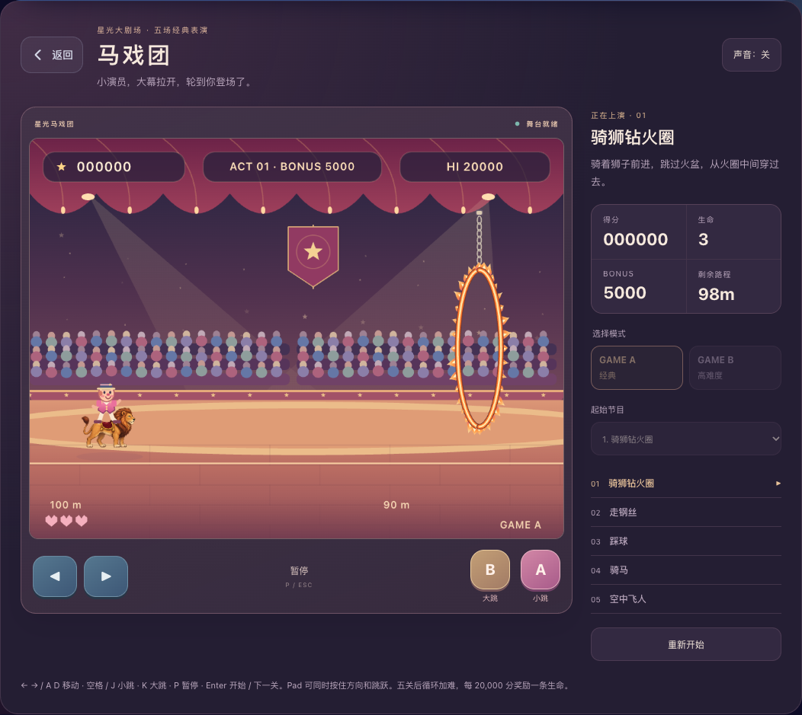

# 马戏团 · 经典玩法与全新童话舞台

更新日期：2026-10-04。

## 定位与入口

用户明确确认（2026-10-04）：**玩法高度还原小霸王原版，画面重新设计；道具要能辨认出原版器械，必要时自行绘制；背景音乐使用 FC 原版。第一关狮子外形需更像狮子，使用 ImageGen 重新绘制。**

以 FC《Circus Charlie》的五节目结构、操作方式、跳跃时机与循环闯关作为玩法基线，不采用街机版额外的独立蹦床关。视觉使用全新现代童话马戏剧场：柔和舞台灯光、绒幕、木地板和重新绘制的人物、动物与器械。画面绘制与规则引擎分离，美术更新不改变碰撞、运动或计分。

入口：空中乐园 → 敏捷 → 马戏团 → 进入马戏团。在 `/lobby` 页内打开，与现有游戏共用单个活动游戏容器。

当前为 Canvas 原生复刻，未运行原版 ROM。角色绘制、碰撞范围与关卡布置重新制作；背景音乐来自原始 FC 音乐数据，不能视为原版程序逐帧一致的模拟器。后续操作手感以 FC 原版为参照，视觉保持现代重设计方向。

## 五个节目

| 节目 | 操作与目标 | 失败条件 |
| --- | --- | --- |
| 骑狮钻火圈 | 左右移动，跳过火盆、穿过悬挂移动火圈，到达终点；火圈进入镜头后开始移动 | 碰到火圈上/下沿或火盆 |
| 走钢丝 | 在红白钢丝上行走、跳过猴子；紫猴速度更快 | 身体碰到猴子 |
| 踩球 | 在滚动球上保持平衡，起跳并调整方向，落到下一颗球上 | 踩空掉落 |
| 骑马 | 马自动奔跑，左右调节速度；A 小跳、B 大跳，跳板自动弹起 | 撞到高低障碍 |
| 空中飞人 | 秋千按照时间摆动，顺势松手，按方向调整空中水平运动，接住下一根杆；跳床可反弹，最后必须落上终点台 | 落到跳床和终点台以外、飞过终点台范围 |

## 模式、生命与计分

- GAME A：经典起始难度；GAME B：从更高难度起步。
- 五关后返回骑狮关，显示累计 STAGE 编号，难度逐轮增加至四档上限；不在第五关后强行结束。
- 开局三条生命。失败后保留分数和剩余生命，手动重试当前完整节目。生命耗尽显示 GAME OVER，可再来一局。
- 每获得 20,000 分补一条生命；一次加分跨越多个阈值时逐次补命。
- 火圈 100 分，高难附加圈 200 分；普通猴子 100 分、紫猴 500 分；落上新球 500 分；越过骑马障碍 100 分；接住新秋千 500 分。每个对象的奖励只领取一次。
- 每关 BONUS 从 5000 开始，每 0.2 秒减 10，通关时剩余 BONUS 加入分数；耗尽时损失一条生命。暂停、重试等待和过关等待不推进计时。
- 最高分保留在本次打开游戏的会话中，初始展示 20,000 分，不写入课程或钱包。
- 开始前可以选择起始节目，方便直接练习后续关卡；开始后禁用模式与节目选择，重新开始返回准备画面。

## 画面与声音

- 舞台使用 960×720 高清 Canvas，平滑缩放；玩法保持原有逻辑坐标，画面独立映射为 4:3 舞台。全站 Web 和 Pad 采用相同玩法参数。
- 紫莓色绒幕、暖金灯串、聚光灯、层叠看台和木质圆形舞台形成全新剧场。小丑穿粉色演出服，狮子、猴子、白马与器械采用有描边、柔和渐变的童话插画风，角色四肢随步伐运动。
- 器械自行绘制：火圈采用悬链、金属环和向外燃烧的连续火焰，中央通行区留空；火盆为带把手、支脚和炭床的铁盆；彩球使用红、蓝、黄、米白相间球瓣并随滚动旋转；跨栏使用红白栏杆、条纹立柱和支脚；跳床显示绷布、钢框、弹簧和斜撑腿；秋千显示双绳、木杆和金属箍。绘制改动不调整原有碰撞尺寸或玩法参数。
- 第一关狮子采用内置 ImageGen 生成的透明 PNG 四帧图集：站立、两帧奔跑、腾空，突出完整铜棕鬃毛、猫科口鼻、四肢和尾尖。按速度、着地状态选择姿势，左行水平镜像；各帧以鞍垫位置对齐，小丑独立绘制，保持原有乘骑位置。入口插画复用同一只狮子的站立帧。减少动态效果时用站立/腾空帧；素材解码完成后自动重绘准备画面，加载失败时保留 Canvas 后备绘制。只更新美术，不修改碰撞、跳跃、速度和音乐。
- 素材保存在 `public/assets/games/circus/lion-atlas-v1.png`（1254×1254，RGBA 真透明），不依赖运行时生成服务。最终提示词见 [lion-imagegen-v1.json](assets/circus/lion-imagegen-v1.json)，由 `src/games/circusLionSprites.ts` 保存帧坐标、鞍垫注册点与绘制缩放参数。
- 入口使用独立 SVG 马戏插画；局内为现代舞台面板和清晰触控按钮，不使用旧像素字模、低分辨率精灵或灰色复古主机外壳。
- 游戏舞台颜色固定；周围操作界面支持全站深浅主题。减少动态效果偏好关闭观众、星光和火焰装饰变化，保留规则必需的运动反馈。
- 背景音乐使用 FC 原版三首音轨，由原始 NSF 音乐驱动通过 2A03 APU 渲染得到，保留原来的旋律、节奏和音色：第一首用于骑狮/骑马，第二首用于钢丝/踩球，第三首用于空中飞人。不再使用自编行进曲/圆舞曲动机。交互短音效仍由 Web Audio 方波合成。
- 音轨本地存储在 `public/assets/circus/audio/`，首次使用按需加载并缓存解码结果，游戏运行不依赖外部音频站点。循环起止点写在 `src/games/circusSoundtrack.json`，采用音乐完整乐句重复段，避免录音结尾淡出和长静音。
- 声音遵循全局设置，开始表演后播放；暂停、关闭声音、切后台和退出停止音乐，继续时重新播放。异步加载期间暂停或退出，完成解码后也不误播。掉命和过关音效独立于背景音乐停止操作。

## Web / Pad 与交互

- Web：←/→ 或 A/D 移动；空格/J/↑ 为 A 键，K 为 B 键；P/Esc 暂停，Enter 开始或进入下一关。
- 键盘事件由舞台 Canvas 接收，避免影响模式选择、下拉框等页面控件。
- Pad：方向与 A/B 使用 Pointer Events 和指针捕获，支持双指同时按住方向并跳跃；释放、取消或失去捕获均清除方向状态。
- 手柄按钮也支持键盘激活。切后台和窗口失焦自动暂停，返回页面后需手动继续。
- Web 为舞台与节目/计分侧栏两列；窄屏转为上下布局，Pad 横竖屏与 390px 窄屏均检查无横向溢出。悬浮 NPC 与学习助手入口在马戏团打开时收起，退出后恢复。

## 游玩记录

- 整局生命耗尽时只结算一次，写入 `gameId: sky-circus`；A/B 分别对应 `level: 1/2`。
- 至少成功完成五场节目时 `correct: 1`，否则为 0；`total: 1`，`stars: 0`。耗时只包含实际进行的模拟时间。
- 循环闯关中的过关等待不重复结算；中途退出或重新开始不写记录，与现有动作游戏弃局口径一致。
- 不发课程星、不发卷星币，不写入课程掌握度。

## 实现与验证

- `src/games/circusEngine.ts`：与 DOM 分离的 60Hz 固定步长规则、运动、碰撞、计分与关卡循环。
- `src/games/circusArtwork.ts`：高清 Canvas 插画、动画、舞台和镜头；`src/games/circusLionSprites.ts`：ImageGen 狮子图集加载、帧选择与乘骑位置对齐；`src/games/CircusCover.tsx`：入口 SVG 插画。
- `src/games/circusAudio.ts`：原版音轨加载、解码缓存、关卡映射、循环播放与短音效生命周期；`circusSoundtrack.json`：音轨出处与循环参数。
- `src/games/CircusGame.tsx` / `circus.css`：准备、进行、暂停、掉命、过关与结束状态，键盘和触屏交互。
- 规则测试：`src/__tests__/circusEngine.test.ts`，覆盖五节目机制、碰撞、计分、补命、重试、循环、超时与五个完整场地的真实控制轨迹。
- 相关 E2E：`e2e/circus.spec.ts`，覆盖入口、模式、键盘、首个火圈、暂停/后台冻结、各节目进入、整局结算、原版三首音轨的实际解码/非静音波形、五关音乐映射、启停与加载期间暂停、Pad 双指操作和窄屏布局。只运行本次新增用例；后续纯 UI 修改不重跑 E2E，改用构建与截图检查。

本次第一关狮子替换为纯 UI 改动：不重跑 E2E，使用 Web / Pad 截图检查站立、奔跑、腾空、左行以及入口插画，并进行 TypeScript、相关 ESLint 和生产构建检查。

## 原版音乐素材记录

原始数据：[Zophar 的 FC《Circus Charlie》NSF 档案](https://www.zophar.net/music/nintendo-nes-nsf/circus-charlie)，其中的 `Circus Charlie (1986-03-04)(Konami)(Soft Pro).nsf`（16,512 字节，15 个音乐/音效条目）。本次从原始 NSF 渲染第 1～3 条，不采用网上翻奏或重新编曲；背景音乐文件不是运行游戏 ROM。

NSF SHA-256：`9cc1986027ad1d6b87bbc6b927686c9aad7ef45306450605aa9dd304df30fa94`。

渲染方式：[Game Music Emu](https://github.com/libgme/game-music-emu) 的 NES 2A03 驱动，NTSC 60.098823Hz、tempo 1.0，44.1kHz PCM；FFmpeg 编码为 96kbps 单声道 MP3。输出保留首个完整乐句和下一轮完整乐句，使用 Web Audio 缓冲源指定循环区间，播放音量为 0.45。

| 本地文件 | 原 NSF 条目 | 节目 | 一轮长度 |
| --- | --- | --- | --- |
| `lion-horse.mp3` | 1 | 骑狮、骑马 | 1344 帧，约 22.363 秒 |
| `wire-balls.mp3` | 2 | 钢丝、踩球 | 1792 帧，约 29.818 秒 |
| `trapeze.mp3` | 3 | 空中飞人 | 1536 帧，约 25.558 秒 |

## 参考

- [FC 版本画面与可操作游戏](https://www.retrogames.cz/play_078-NES.php)：用于区分 FC 五节目与街机六节目。
- [骑狮关 FC 画面](https://cdn-ak.f.st-hatena.com/images/fotolife/M/Mr_anpontan2020/20220922/20220922230925.png)：用于确认玩法元素与相对位置；不照搬像素美术。
- [原街机说明书扫描](https://crazykong.com/manuals/CircusCharlie.man.pdf)：仅作马戏表演的背景参考，节目结构以 FC 版本为准。
